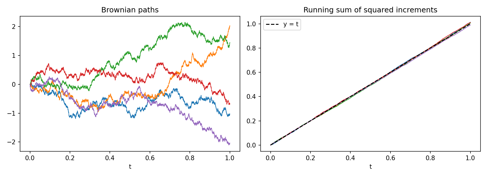
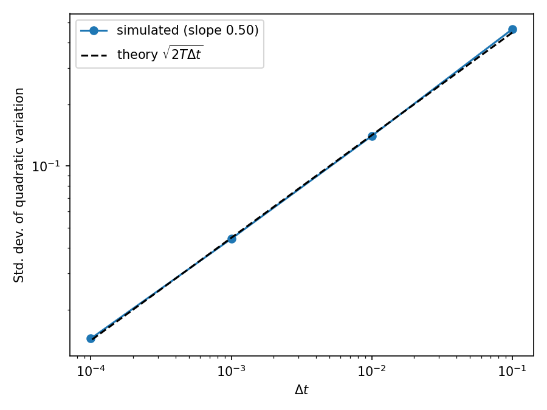
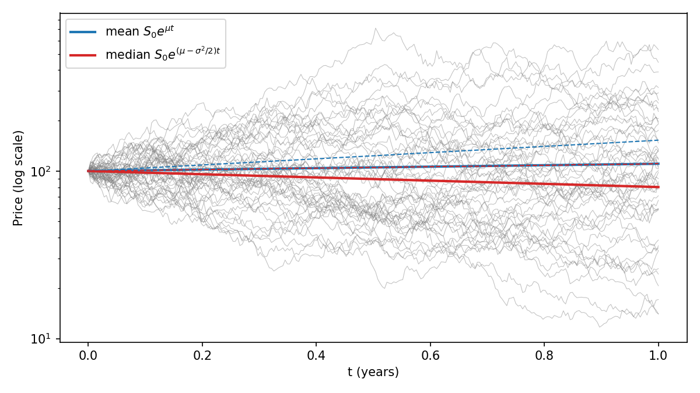
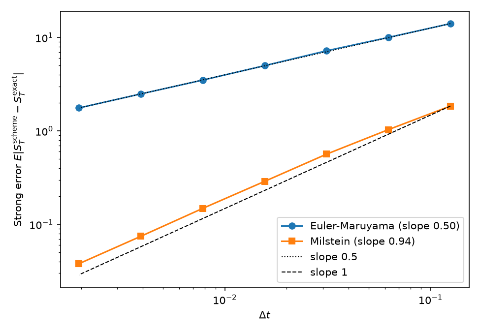
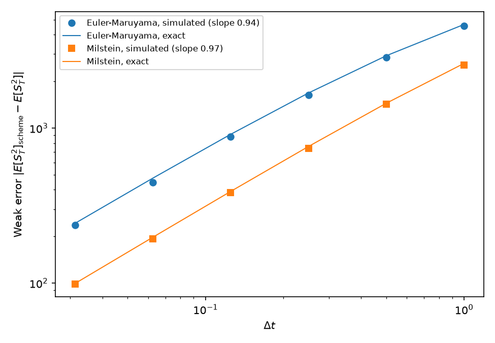

# Stochastic calculus by simulation

Stock prices are usually modelled with Brownian motion, which is so jagged that ordinary calculus stops working on it. I wanted to see the strange rules of stochastic calculus for myself rather than just take them on trust, so I simulated them. Then I used them to test how well two common methods simulate a stock price.

## Squared steps that add up to time

If you take a smooth curve, chop it into tiny pieces and add up the squares of the changes, you get zero in the limit. Brownian motion is different: the squared changes add up to exactly the elapsed time. That one fact is why stochastic calculus needs its own version of the chain rule.



The five paths on the left go in completely different directions, but on the right, their running sums of squared steps all sit on the line y = t. They're random, but they're all equally rough.



With coarse steps the sum is still quite random, but as the steps get finer it gets pinned to 1. Working it out by hand, the spread should shrink like √(2Δt), and the simulation matched that almost exactly, with a slope of 0.502 against the predicted 0.5.

## Why the average and the typical outcome split apart

Itô's lemma gives the exact formula for a stock price under the standard model, and it contains a −σ²/2 term that ordinary calculus would miss. The effect is that the average price grows at the drift μ, but the typical price grows more slowly, at μ − σ²/2.



I used a volatility of 80%, roughly Bitcoin's, to make it obvious. With a 10% expected return, the average price after a year rose to about 111, but the median fell to about 80, and 61% of paths ended below where they started. A few paths shoot up and drag the average with them, while most quietly lose money.

When I deleted the −σ²/2 term, the average jumped to about 153. So ignoring the correction would overstate the expected price by nearly 40%.

## Is each simulated path right?

Most models don't have an exact formula, so you have to simulate them step by step. I compared the simplest method, Euler-Maruyama, with Milstein's, which adds one small correction term. Because this model does have an exact formula, I could run both methods on the same random paths as the exact answer and measure how far off they ended up.



Euler-Maruyama's error shrank like √Δt, exactly as theory says. Milstein's shrank roughly twice as fast: once the steps were small enough, halving them halved the error. With 512 steps, Milstein was 46 times more accurate. To match that, Euler-Maruyama would need about 2,000 times as many steps.

One thing I had to get right: every step size has to use the same underlying random path, otherwise you're comparing different paths rather than different step sizes. I simulated one fine path and built the coarser ones by adding up its small steps.

## Is the average right?

For pricing an option, you don't need each path to be right, just the average. I tested this with the average of the squared price, because Milstein's correction averages out to zero, so both methods give exactly the same average price. That made the plain average useless for telling them apart.



Here both methods improved at the same rate, so Milstein's advantage mostly disappears: it's about 2.4 times more accurate, but the lines stay parallel. I also worked out each method's answer by hand, and the simulation landed within a few percent of it. The practical takeaway is that if you only care about prices, the simpler method converges just as fast.

## Running it

```bash
conda create -n quant python=3.11 numpy scipy matplotlib pandas -y
conda activate quant
python src/quadratic_variation.py
python src/gbm_exact.py
python src/strong_convergence.py
python src/weak_convergence.py
```

Each script prints its results and saves its figure. The random seeds are fixed, so you'll get the same numbers I did.